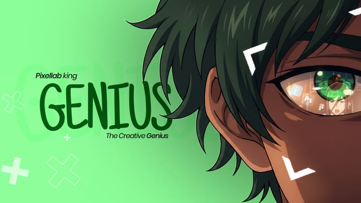
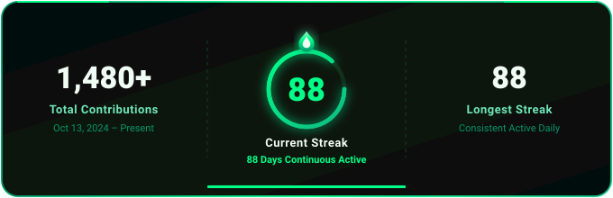

  <!-- Hero Banner: User's Custom Emerald Green Artwork -->
  

    

  <!-- Dynamic Typing Subtitle in Electric Emerald (#00FF88) -->
  

  <!-- Status & Social Badges in Cyber Emerald Palette -->
  

    
    &nbsp;
    
    &nbsp;
    
    &nbsp;
    
    &nbsp;
    
  

---

###  Executive Overview

I am a **17-year-old Systems & Full-Stack Developer** (Class 12th Senior Secondary) and the founder of **Bratz Inc.** I bridge the gap between high-level web engineering and low-level operating system internals, building autonomous agentic architectures, mission-critical enterprise systems, and high-velocity software.

- 🎓 **Academic Foundations**: High school senior (Class 12th) balancing academic rigor with architecting production-scale applications.
- ⚡ **Full-Stack Mastery**: Deeply specialized in **React 19, Next.js 15, Node.js, TypeScript, Python, and Java**, delivering ultra-responsive reactive UIs, sub-millisecond API pipelines, and robust state machines.
- 🤖 **Autonomous AI & Agentic Orchestration**: Engineering autonomous multi-agent swarms, self-correcting generation pipelines, and multi-model AI bridges with function calling.
- 🛡️ **Systems & Forensic Security**: Developing low-level Windows latency tuners, anti-cheat threat detectors, anti-tunnel forensic inspectors, and NT kernel driver scanners.
- 🎨 **Creative Design & Media**: High-fidelity UI/UX design, visual branding, Adobe Photoshop, After Effects, and mobile graphic engineering (*Pixellab King*).

---

### 💡 Philosophy & The Mission

<table>
  <tr>
    <td width="50%" valign="top">
      <h4 align="center">⚡ The Engineering Philosophy</h4>
      

        <i>"Building software that bridges raw OS machine efficiency with autonomous AI intelligence — turning imagination into hardened production code without compromise."</i>
      

      

        Every architecture is built with strict type safety, zero-bloat modularity, sub-second latency targets, and resilient error recovery.
      

    </td>
    <td width="50%" valign="top">
      <h4 align="center">🎯 The Core Mission</h4>
      

        <i>"Creating autonomous agent swarms, modern educational ERP platforms, and low-level forensic tooling that empower users with unparalleled speed, privacy, and utility."</i>
      

      

        Eliminating repetitive human bottlenecks through self-orchestrating AI agents and high-performance native runtimes.
      

    </td>
  </tr>
</table>

---

###  Flagship Projects & Architectures

<table>
  <tr>
    <td colspan="2" valign="top">
      <h3 align="center"> Elevate ERP &mdash; Autonomous Agent-Powered School & Enterprise Platform</h3>
      

        <b>The World's 1st Autonomous Agent-Powered Educational ERP System <code>[Private Enterprise Core]</code></b>
      

      

        An enterprise school resource planning platform engineered from the ground up with autonomous AI agent swarms. Replaces administrative bottlenecks with automated double-entry accounting, CBSE/NCERT blueprint-aligned AI exam paper generation (deduplication, token repair, high-volume synthesis), multi-tenant subscription ledgering, Razorpay payment automation, live student rosters, and resilient offline-first caching.
      

      

        <code>Autonomous Agents</code> &bull; <code>Enterprise ERP</code> &bull; <code>React 19</code> &bull; <code>Next.js 15</code> &bull; <code>TypeScript</code> &bull; <code>Python</code> &bull; <code>Node.js</code> &bull; <code>Razorpay</code> &bull; <code>Private Core</code>
      

    </td>
  </tr>
  <tr>
    <td width="50%" valign="top">
      <h3 align="center">📱 D-Detect: Mobile Evidence Vault</h3>
      

        <b>Smart Chronological Daybook & Evidence Forensic Assistant <code>[Client Project - Private]</code></b>
      

      

        Full-stack privacy-first mobile evidence tracking and timeline management system for Android. Features an encrypted daybook, AI conversational query assistant with direct source citations, spending dispute forensics, After Effects-grade detective character animations with physics (eyelid blinking & fedora wobble), and background cloud sync.
      

      

        <code>React Native</code> &bull; <code>Expo SDK</code> &bull; <code>Express</code> &bull; <code>Firebase Firestore</code> &bull; <code>Mobile Vault</code>
      

    </td>
    <td width="50%" valign="top">
      <h3 align="center"> Free AI Bridge</h3>
      

        <b>High-Performance Multi-Model AI Proxy <code>[Open Source]</code></b>
      

      

        Resilient proxy bridge integrating Gemini and ChatGPT into SaaS backends with full OpenAI API compatibility. Features cookie-based session management, intelligent failover routing, vision support, function calling, JSON mode, and real-time streaming tokens with zero API markups.
      

      

        <a href="https://github.com/egon999/free-ai-bridge"><b>View Repository &rarr;</b></a> 
        <code>Python</code> &bull; <code>OpenAI API</code> &bull; <code>Gemini</code> &bull; <code>ChatGPT</code> &bull; <code>SaaS Gateway</code>
      

    </td>
  </tr>
  <tr>
    <td colspan="2" valign="top">
      <h3 align="center"> ATLAS by Bratz &mdash; Windows Latency Suite & Forensic Scanner</h3>
      

        <b>Low-Level Windows Performance Tuner & Anti-Cheat Threat Forensics</b>
      

      

        High-performance Windows OS latency optimizer and anti-cheat reverse-engineering forensic inspector built with <b>Rust</b>, <b>Tauri v2</b>, <b>C++</b>, and <b>Win32/NT internals</b>. Features multi-tier forensic inspection detecting remote thread injections (<code>svchost.exe</code>), anti-tunneling network forensic analysis, root droppers, and kernel exploit drivers.
      

      

        <code>Rust</code> &bull; <code>Tauri v2</code> &bull; <code>Win32 API</code> &bull; <code>C++</code> &bull; <code>C#</code> &bull; <code>NT Internals</code> &bull; <code>Anti-Cheat Forensics</code>
      

    </td>
  </tr>
</table>

---

###  Technical Arsenal

#### Full-Stack Web & Application Engineering

#### Autonomous AI & Agentic Orchestration

#### Low-Level Systems & Security Forensics

#### Graphic Design & Creative Media

---

###  Activity & Telemetry

  

    
    &nbsp;
    
    &nbsp;
    
  

   

  <!-- High-Tech Neon Emerald Streak Card (88 Days Active & Telemetry) -->
  

---

###  Connect & Community

  
Building ambitious architectures, agent swarms, or joining the Bratz Inc ecosystem?

  
  &nbsp;&nbsp;
  
  &nbsp;&nbsp;
  

    
  Engineered with precision &bull; Powered by <b>Bratz Inc.</b>

